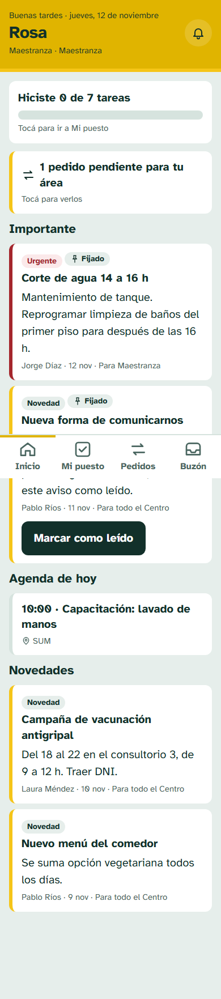
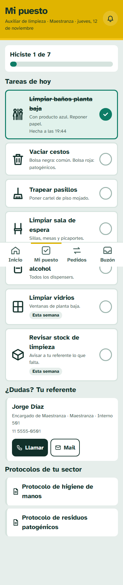
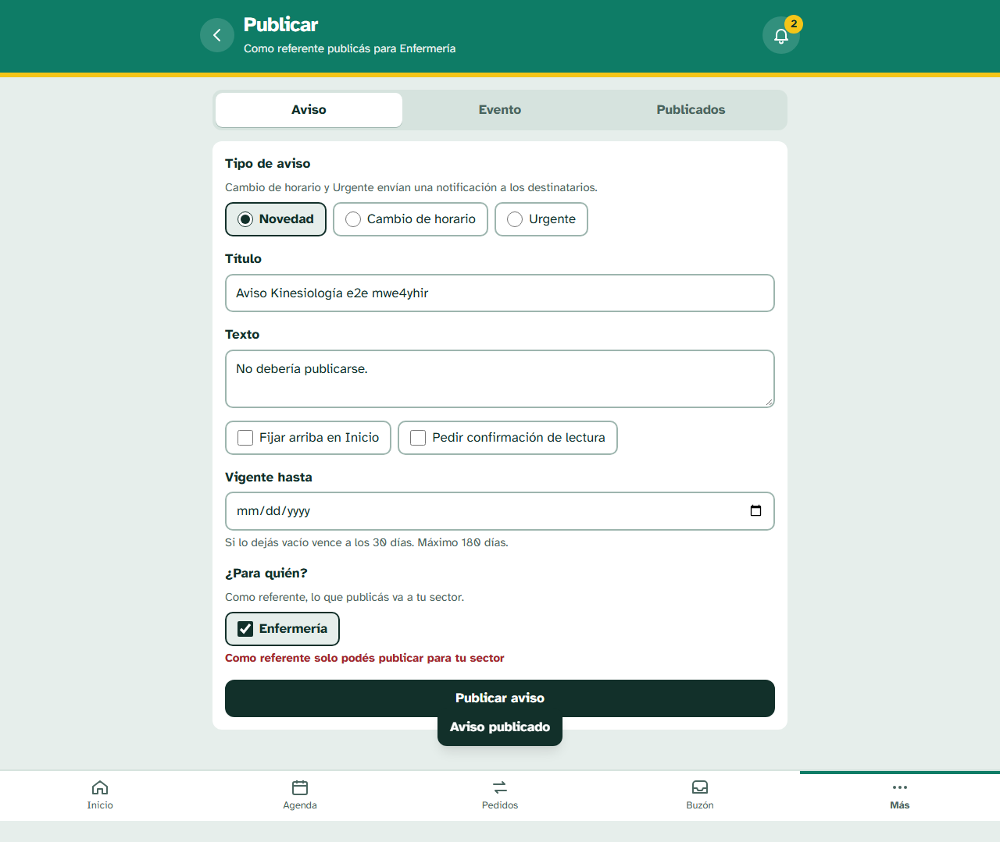
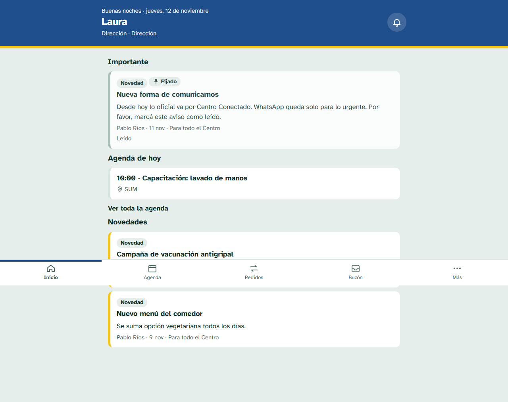
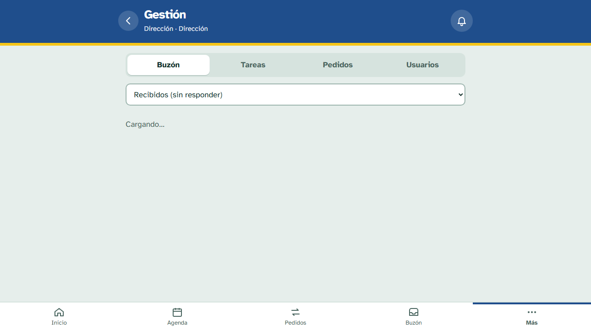
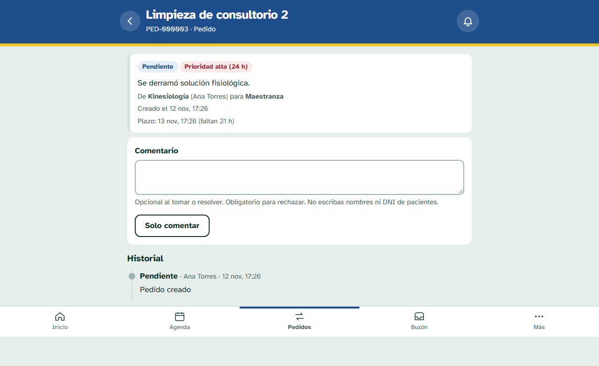
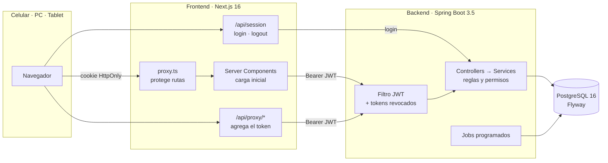

# Centro Conectado

**Plataforma de comunicación interna para centros de salud.** Una sola web app, que se abre desde el celular sin instalar nada, se vuelve la fuente oficial de información del centro: avisos con confirmación de lectura, agenda, checklist diario por puesto, pedidos entre áreas con plazos, buzón anónimo y directorio. Cada persona ve una versión distinta según su rol.


> Proyecto de tesis de **Jeremías Galetto**, Técnico Superior en Desarrollo de Software.
> Diseñado para poder implementarse en producción en el **Centro Jerárquicos de Santa Fe (capital), Argentina**.

---

## Índice

- [El problema](#el-problema)
- [La propuesta](#la-propuesta)
- [Qué resuelve, módulo por módulo](#qué-resuelve-módulo-por-módulo)
- [Una app, seis experiencias: roles y vistas](#una-app-seis-experiencias-roles-y-vistas)
- [Capturas](#capturas)
- [Arquitectura](#arquitectura)
- [Seguridad y privacidad](#seguridad-y-privacidad)
- [Calidad: cómo se prueba](#calidad-cómo-se-prueba)
- [Puesta en marcha local](#puesta-en-marcha-local)
- [Despliegue en producción](#despliegue-en-producción)
- [API](#api)
- [Estructura del repositorio](#estructura-del-repositorio)
- [Hoja de ruta](#hoja-de-ruta)
- [Autor](#autor)

---

## El problema

En un centro de salud la información interna circula por canales que no fueron pensados para eso:

- **Grupos de WhatsApp** donde lo importante se pierde entre mensajes, no queda registro de quién leyó un cambio de horario y se mezclan datos personales con temas de trabajo.
- **Carteleras en papel** que nadie actualiza y que el turno noche no ve.
- **Pedidos entre áreas de palabra o por mensaje**, sin plazo, sin responsable y sin forma de saber si quedaron resueltos.
- **Protocolos en carpetas compartidas**, con versiones vencidas conviviendo con las vigentes.
- **Personal de maestranza y limpieza** que muchas veces queda afuera de las herramientas digitales porque están diseñadas para otros perfiles.

El costo no es solo de comodidad: un cambio de protocolo que no se leyó, o una interconsulta que quedó olvidada, impactan directamente en la atención.

## La propuesta

Centro Conectado ordena esa comunicación con una regla simple: **lo oficial va por la app y WhatsApp queda para lo urgente.**

- **Trazabilidad.** Los avisos importantes piden confirmación de lectura, y quien publica ve quién leyó y quién falta.
- **Plazos y responsables.** Cada pedido entre áreas tiene prioridad, plazo (24 h, 72 h o 7 días), estado e historial completo.
- **Vigencia obligatoria.** Avisos y documentos vencen solos (30 días por defecto, 180 como máximo), y quien los publicó recibe un aviso tres días antes para renovarlos.
- **Inclusión real.** El personal de maestranza tiene una vista simplificada con íconos grandes, texto de 19 px o más, botones de 56 px o más y solo cuatro opciones.
- **Sin instalación.** Funciona en cualquier celular con navegador, en la PC de un consultorio o en la tablet de la sala de descanso.
- **Sin datos de pacientes, por diseño.** No existe ningún campo para cargarlos. Más detalle en [Seguridad y privacidad](#seguridad-y-privacidad).

## Qué resuelve, módulo por módulo

| Módulo | Qué hace |
|---|---|
| **Inicio** | Todo lo del día en una pantalla: avisos fijados y de lectura obligatoria con "Marcar como leído", agenda de hoy, novedades, pedidos pendientes del área y avance de tareas. |
| **Avisos** | Tres tipos: novedad, cambio de horario y urgente (los dos últimos notifican al sector). Se pueden fijar, pedir confirmación de lectura y dirigir a todo el centro o a sectores. Incluye panel de lecturas con porcentaje y lista de pendientes, y renovación o baja. |
| **Agenda** | Vista semanal de eventos, capacitaciones y reuniones, con recordatorio automático configurable. "Agregar a mi calendario" exporta un `.ics` para que el celular ponga la alarma. |
| **Mi puesto** | Checklist diario y semanal por sector y puesto, con ícono por tarea. Muestra el avance del día, el contacto del referente con botón de llamada y los protocolos del sector. El referente ve en tiempo real el avance de cada persona. |
| **Pedidos entre áreas** | Pedidos e interconsultas con código (`PED-000123`), prioridad y plazo. Siguen el circuito pendiente, en curso y resuelto o rechazado (con motivo obligatorio), y quien pidió puede cancelarlo. Bandejas de recibidos y enviados, y tablero general para Dirección con los vencidos. |
| **Buzón** | Consultas, sugerencias y reclamos con plazo de respuesta de 72 h. El **anonimato es real**: si se elige, el sistema no guarda ni autor ni sector, y el seguimiento se hace con un código único. |
| **Quién es quién** | Directorio con búsqueda, teléfono, interno, WhatsApp y mail. Incluye "¿A quién acudo?" por tema y sectores con su referente. |
| **Biblioteca** | Protocolos, manual de inducción, reglamentos, documentación institucional y kit de bienvenida, con categoría, versión, vigencia y marca de "por vencer". |
| **Notificaciones** | Bandeja in-app con contador en la campanita. Avisa de urgentes, cambios de horario, pedidos nuevos o actualizados, respuestas del buzón, recordatorios de agenda y contenido por vencer, y los lunes a las 8:00 envía un resumen semanal. |
| **Gestión** | Según permisos: responder el buzón, armar el checklist de cada sector, ver el tablero de pedidos y administrar usuarios (alta, contraseña temporal, baja). |

## Una app, seis experiencias: roles y vistas

| Rol | Vista | Además de lo básico, puede… |
|---|---|---|
| **Dirección** | Completa | Todo: publicar para cualquier sector, ver lecturas, gestionar el buzón, la biblioteca, los usuarios y el tablero de pedidos. |
| **Calidad y comunicación** | Completa | Lo mismo que Dirección, salvo crear usuarios de Dirección. |
| **Referente de sector** | Completa | Publicar avisos y eventos **solo para su sector**, armar el checklist de su sector, seguir el avance y ver quién leyó lo que publicó. |
| **Profesional** / **Administrativo** | Completa | Lo básico. |
| **Maestranza** | **Simple** | Lo básico, con íconos grandes, texto breve y 4 botones: Inicio, Mi puesto, Pedidos y Buzón. |

**Lo básico, para todos:** leer y confirmar avisos, ver la agenda, tildar sus tareas, hacer y seguir pedidos, escribir al buzón (con opción anónima) y consultar el directorio y la biblioteca.

La interfaz se adapta al rol, pero **los permisos los controla el servidor en cada operación**. Un botón oculto no es un control de acceso, y las pruebas lo verifican intentando las operaciones prohibidas directamente contra la API.

## Capturas

Las capturas las genera la suite de pruebas de punta a punta contra el sistema real con datos de demostración ([`frontend-next/tests/e2e/capturas`](frontend-next/tests/e2e/capturas)).

| Maestranza: Inicio (vista simple) | Maestranza: Mi puesto | Referente: alcance de publicación |
|---|---|---|
|  |  |  |

| Dirección: Inicio | Dirección: Gestión del buzón | Dirección: detalle de pedido |
|---|---|---|
|  |  |  |

## Arquitectura



**El navegador nunca habla con el backend directamente ni ve el token.** El servidor de Next.js guarda el JWT en una cookie `HttpOnly` y es el único que llama a la API. Por eso el backend puede quedar en la red interna, sin exposición a Internet.

### Stack

| Capa | Tecnología | Por qué |
|---|---|---|
| Backend | **Java 21, Spring Boot 3.5**, Spring Security, Spring Data JPA | Ecosistema maduro y estándar en salud y gobierno, fácil de mantener por equipos locales. |
| Autenticación | JWT (jjwt 0.12) stateless, 12 h, con lista de revocación | Escala sin sesión en servidor. El logout invalida el token de verdad. |
| Base de datos | **PostgreSQL 16** (H2 en desarrollo), migraciones con **Flyway** | Esquema versionado y reproducible. Nunca se edita una migración aplicada. |
| Documentación de API | springdoc / **Swagger UI** | Contrato navegable y probable desde el navegador. |
| Frontend | **Next.js 16** (App Router, Cache Components), **React 19**, **TypeScript strict** | Render en servidor, rutas protegidas y streaming. Sin `any` en todo el código. |
| Estilos | **Tailwind CSS 4** con paleta propia y tipografía **Atkinson Hyperlegible** | Fuente diseñada para baja visión, con contraste AA. |
| Estado y formularios | **Zustand** (solo sesión y contador), **Zod** (validación) | Los mensajes de Zod son idénticos a los del backend: el error se ve igual venga de donde venga. |
| Pruebas | **JUnit + MockMvc**, **Vitest**, **Playwright** | Del servicio a la pantalla, contra el sistema real. |

### Organización del código

- **Backend por módulo** (`usuarios`, `avisos`, `agenda`, `notificaciones`, `puesto`, `pedidos`, `buzon`, `biblioteca`, `inicio`, `jobs`). Cada uno tiene entidad, repository, service (reglas y permisos), controller (solo HTTP) y DTOs `record`. Las excepciones de dominio pasan por un manejador global con un formato único de error: `{ status, mensaje, campos }`.
- **Frontend por pantalla** (`src/features/<pantalla>`). Cada pantalla combina un Server Component para la carga inicial, un Client Component para las acciones y un schema Zod para sus formularios. El cliente HTTP es uno solo (`src/lib/api`), con un archivo de endpoints por módulo y los tipos de todos los DTOs en `src/lib/tipos.ts`.

### Procesos automáticos

| Cuándo | Qué hace |
|---|---|
| Cada minuto | Envía los recordatorios de agenda. |
| Todos los días a las 7:00 | Avisa a cada autor lo que vence en 3 días y a Dirección los mensajes del buzón fuera de plazo. |
| Lunes a las 8:00 | Envía a cada persona el resumen semanal: avisos, agenda y pedidos pendientes y vencidos. |
| Todos los días a las 3:00 | Limpia los tokens revocados que ya vencieron. |

## Seguridad y privacidad

**Sin datos de pacientes, por diseño.** El modelo de datos no tiene ningún campo para nombres, DNI ni historia clínica. Si un pedido necesita referirse a un paciente se usa "habitación 12" o "ver HC", y la pantalla lo recuerda junto al campo. El sistema queda así fuera del tratamiento de datos de salud, que la Ley 25.326 de Protección de Datos Personales considera sensibles.

| Riesgo | Cómo se mitiga |
|---|---|
| Robo de sesión por XSS | El JWT vive en una cookie `HttpOnly` y `SameSite=Lax` (con `Secure` en producción), así que el JavaScript del navegador nunca lo ve. No se usa `dangerouslySetInnerHTML`: todo dato del servidor se muestra como texto. |
| CSRF | Además de `SameSite=Lax`, el proxy rechaza toda operación que no sea GET si viene de otro origen. |
| Sesión que sigue viva después de salir | **Logout real**: el id del token (`jti`) queda revocado en el servidor hasta su vencimiento. |
| Acceso por rol | `@PreAuthorize` en cada endpoint y reglas de alcance en los servicios: un referente solo publica y gestiona su sector. Ocultar un botón no es control de acceso. |
| Fuerza bruta en el login | Después de 5 intentos fallidos, el usuario queda bloqueado 10 minutos. |
| Redirecciones abiertas | El parámetro `volver` solo acepta rutas propias, validadas incluso decodificadas. |
| Manipulación de rutas al backend | El proxy solo reenvía segmentos con caracteres seguros (nada de `..` ni `%2F`). |
| Anonimato del buzón | Si el mensaje es anónimo no se guardan autor ni sector. El código de seguimiento (10 caracteres, `SecureRandom`) es la única forma de verlo, y solo se recuerda en el dispositivo que lo envió. |
| Contraseñas | Se guardan con BCrypt. El primer ingreso y toda contraseña temporal obligan a cambiarla. |

## Calidad: cómo se prueba

**72 pruebas automáticas en verde**, en tres niveles:

| Nivel | Herramienta | Cantidad | Qué cubre |
|---|---|---|---|
| API de punta a punta | JUnit 5 + MockMvc sobre H2 | 9 | Login y bloqueo, permisos por rol, alcance del referente, circuito de estados de un pedido, anonimato del buzón, notificaciones que se bajan al leer, logout que invalida el token. |
| Lógica del frontend | Vitest | 58 | Menús y permisos por rol, fechas (con una prueba específica del bug "día anterior" por zona horaria), validación de redirecciones, cliente HTTP y manejo de errores, y schemas Zod con los mismos mensajes que el backend. |
| Navegador real | Playwright (Chromium) | 5 escenarios | Ver el detalle abajo. |

Los escenarios de Playwright:

- **Dirección** recorre todas las pantallas sin errores en la consola, publica un aviso y lo ve en Inicio. Después **maestranza** lo marca como leído y su campanita baja, en pantalla y en el servidor.
- **Maestranza**, en un celular de 390×844, tiene una barra de 4 botones con objetivos táctiles de 56 px o más. Tilda y destilda una tarea, y si intenta publicar es rechazada.
- **Cerrar sesión** deja inválido el token aunque alguien lo hubiera copiado.
- **Referente de Enfermería** publica para su sector. Si se manipula el formulario para publicar en Kinesiología, el error aparece en su campo y la API lo rechaza igual.

## Puesta en marcha local

**Requisitos:** JDK 21, Maven 3.9 o superior y Node.js 22. Docker es opcional, solo para PostgreSQL.

```bash
# 1. Backend (perfil dev: H2 en archivo + datos de demostración)
cd backend
mvn spring-boot:run                      # http://localhost:8080 · Swagger: /swagger-ui.html

# 2. Frontend
cd frontend-next
npm install
npm run dev                              # http://localhost:3000
```

En desarrollo, la pantalla de ingreso muestra "Probar con un rol" para entrar con un clic. Todos los usuarios de demostración usan la contraseña `Centro2026!`:

| Usuario | Rol | Sector |
|---|---|---|
| `direccion` | Dirección | Dirección |
| `comunicacion` | Calidad y comunicación | Calidad y Comunicación |
| `referente.enf` / `enfermero` | Referente / Profesional | Enfermería |
| `referente.kin` / `kinesio` | Referente / Profesional | Kinesiología |
| `administracion` | Administrativo | Administración |
| `referente.mae` / `maestranza` | Referente / Maestranza (vista simple) | Maestranza |

**Correr todas las pruebas:**

```bash
cd backend && mvn verify                                   # API
cd frontend-next && npx playwright install chromium        # solo la primera vez
npm run build && npm run typecheck && npm run lint && npm test && npm run test:e2e
```

Los e2e necesitan el backend levantado. Crean sus propios datos de prueba y los borran al terminar.

**Probar desde un celular:** con el celular y la PC en la misma red, corré `npm run dev -- -H 0.0.0.0` y entrá a `http://<IP-de-la-PC>:3000`.

## Despliegue en producción

El sistema está pensado para el servidor de un centro de salud: dos procesos y una base PostgreSQL, sin servicios externos pagos.

```
Internet / red del centro ──HTTPS──▶ Nginx (TLS) ──▶ Next.js :3000 ──red interna──▶ Spring Boot :8080 ──▶ PostgreSQL
```

**1. Base de datos.** PostgreSQL 16, ya sea con el `docker-compose.yml` incluido o con una instancia administrada. Flyway crea y actualiza el esquema al arrancar.

**2. Backend:**

```bash
cd backend && mvn -DskipTests package
SPRING_PROFILES_ACTIVE=postgres \
DB_URL=jdbc:postgresql://<host>:5432/centro_conectado DB_USER=<usuario> DB_PASSWORD=<clave> \
JWT_SECRET="$(openssl rand -base64 48)" APP_SEED=false \
java -jar target/*.jar
```

**3. Frontend:**

```bash
cd frontend-next && npm ci && npm run build
BACKEND_URL=http://<backend-interno>:8080 MODO_DEMO=false npm start
```

**4. HTTPS.** Un proxy inverso (Nginx, Caddy o el balanceador del centro) termina TLS delante de Next.js. El backend **no necesita exponerse**: solo lo consume el servidor de Next.js.

### Variables de entorno

| Variable | Dónde | Producción |
|---|---|---|
| `SPRING_PROFILES_ACTIVE` | backend | `postgres` |
| `DB_URL`, `DB_USER`, `DB_PASSWORD` | backend | Credenciales de PostgreSQL. |
| `JWT_SECRET` | backend | **Obligatorio.** Generalo con `openssl rand -base64 48`. |
| `APP_SEED` | backend | `false` (no cargar datos de demostración). |
| `BACKEND_URL` | frontend | URL interna del backend. |
| `MODO_DEMO` | frontend | `false` (oculta el acceso rápido por rol). |
| `COOKIE_SECURE` | frontend | Por defecto `true` en producción. Se baja a `false` solo para pruebas por http. |

### Lista de verificación antes de salir a producción

- [ ] `JWT_SECRET` propio y guardado fuera del repositorio.
- [ ] `APP_SEED=false` y `MODO_DEMO=false`.
- [ ] HTTPS activo y backend accesible solo desde el servidor del frontend.
- [ ] Usuarios reales cargados desde Gestión → Usuarios, con contraseña temporal (cada persona la cambia en su primer ingreso).
- [ ] Referentes asignados por sector y checklist de tareas cargado.
- [ ] Biblioteca con los protocolos oficiales del centro.
- [ ] Backup diario de PostgreSQL (`pg_dump`) con prueba de restauración.

## API

Contrato completo y navegable en **Swagger UI**: `http://localhost:8080/swagger-ui.html`. Todas las rutas van bajo `/api` y requieren `Authorization: Bearer <JWT>`, salvo el login.

| Módulo | Endpoints principales |
|---|---|
| Autenticación | `POST /auth/login` · `GET /auth/me` · `POST /auth/cambiar-password` · `POST /auth/logout` |
| Inicio | `GET /inicio` (todo en un request) · `GET /resumen-semanal` |
| Avisos | `GET/POST /avisos` · `POST /avisos/{id}/leido` · `GET /avisos/{id}/lecturas` · `GET /avisos/publicados` · `GET /avisos/por-vencer` · `POST /avisos/{id}/renovar` |
| Agenda | `GET/POST /agenda` · `GET /agenda/{id}/ics` |
| Mi puesto | `GET /mi-puesto` · `POST/DELETE /mi-puesto/tareas/{id}/completar` · `GET /puesto/avance` · `GET/POST/PUT/DELETE /puesto/tareas` |
| Pedidos | `GET /pedidos/recibidos`, `/enviados`, `/todos` · `POST /pedidos` · `PATCH /pedidos/{id}/estado` · `POST /pedidos/{id}/comentarios` |
| Buzón | `POST /buzon` · `GET /buzon/mios` · `GET /buzon/seguimiento/{codigo}` · `GET /buzon/gestion` · `POST /buzon/{id}/responder` |
| Directorio | `GET /directorio?q=` · `GET /sectores` · `GET /a-quien-acudir` |
| Biblioteca | `GET/POST /biblioteca` · `PUT /biblioteca/{id}` · `POST /biblioteca/{id}/renovar` |
| Notificaciones | `GET /notificaciones` · `GET /notificaciones/contador` · `POST /notificaciones/{id}/leida` · `POST /notificaciones/leer-todas` |
| Administración | `GET/POST /admin/usuarios` · `PUT /admin/usuarios/{id}` · `POST /admin/usuarios/{id}/reset-password` · `PUT /admin/sectores/{id}/referente` |

Los errores siempre responden `{ status, mensaje, campos }`, y `campos` trae el mensaje de cada dato inválido.

## Estructura del repositorio

```
centro-conectado/
├── backend/                         API REST · Spring Boot 3.5 · Java 21
│   ├── src/main/java/.../api/       un paquete por módulo (avisos, pedidos, buzon, ...)
│   ├── src/main/resources/db/migration/   migraciones Flyway versionadas
│   ├── src/test/                    pruebas de punta a punta de la API
│   └── docker-compose.yml           PostgreSQL 16 para desarrollo
└── frontend-next/                   Web app · Next.js 16 · TypeScript
    ├── app/                         rutas: (publico)/login, (app)/* protegidas, api/session, api/proxy
    ├── proxy.ts                     protección de rutas por cookie
    ├── src/lib/                     cliente HTTP, permisos, fechas, tipos de la API
    ├── src/features/                una carpeta por pantalla (componentes + schema Zod)
    ├── src/components/ui/           sistema de componentes accesibles
    └── tests/                       unit (Vitest) · e2e (Playwright) + capturas
```

## Hoja de ruta

Lo construido cubre el circuito completo de comunicación interna. Las próximas etapas previstas son:

1. **Notificaciones push** (Web Push con VAPID) para avisar con la app cerrada. El servicio de notificaciones ya tiene un único punto de emisión preparado para engancharlo.
2. **PWA**: "Agregar a pantalla de inicio" y lectura sin conexión de la biblioteca.
3. **Subida de archivos** a la biblioteca. Hoy se carga el enlace al documento.
4. **Modo cartelera** para la tablet de la sala de descanso: avisos generales y agenda del día rotando en pantalla completa.
5. **Integración con el directorio institucional** (LDAP o SSO) para el alta automática de usuarios.
6. **Métricas para Dirección**: tasa de lectura por sector, tiempos de resolución de pedidos y cumplimiento de checklists.

## Autor

**Jeremías Galetto**
Técnico Superior en Desarrollo de Software
Santa Fe, Argentina

Proyecto desarrollado como tesis, con alcance y diseño orientados a su implementación en producción en el **Centro Jerárquicos de Santa Fe (capital)**.

---

© 2026 Jeremías Galetto. Todos los derechos reservados.
